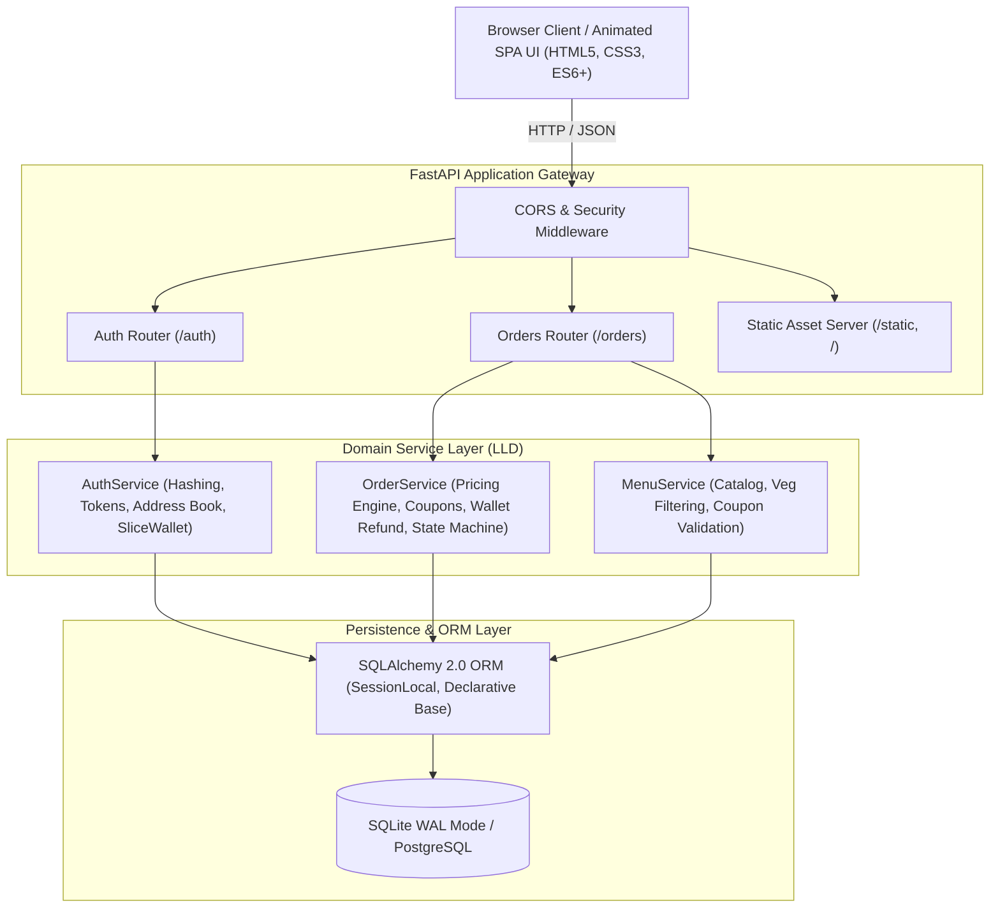

# 🍕 SliceCraft Artisanal Pizza Delivery & Kitchen Dispatch Platform

A production-grade, highly responsive, full-stack Pizza Delivery and Kitchen Dispatch platform built with **FastAPI**, **SQLAlchemy 2.0**, **Pydantic**, **JWT Authentication (RBAC)**, and an appetizing **"Edible UI" Single Page Application (SPA)** frontend in Indian Rupees (INR ₹).


---

## 🌟 Key Highlights & Features

- 🇮🇳 **Rupee Economy & Algorithmic Pricing**: Complete Indian Rupee (INR ₹) standard across models, database, and client. Free delivery on orders above ₹399, standard ₹49 delivery fee, and 5% GST calculation.
- 🍕 **Artisanal Menu & Pure Veg Filtering**: Hand-stretched wood-fired pizza selections with dynamic category filtering (Classic, Vegetarian, Meat Lovers, Specialty, Sides & Dips, Desserts), FSSAI green/red dot indicators, and instant search.
- 🛵 **Delivery vs Takeaway Switcher**: Toggle between 30-minute home delivery and instant 15-minute takeaway pickup with automatic delivery fee waivers.
- 🎟️ **Promo Deals & Coupons Engine**: Real-time coupon validation (`FIRSTBITE`, `SLICE100`, `CHEESELOVER`, `FREEDEL`) with live subtotal constraint checks and discount breakdown.
- 👛 **SliceWallet & Loyalty Ledger**:
  - ₹500 welcome bonus on customer registration.
  - Automatic 5% cashback on delivered orders credited back to SliceWallet.
  - 1-click instant wallet checkout with audit transaction history.
  - Instant wallet refund on pending order cancellation.
- 📍 **Saved Address Book**: Multi-location manager (Home, Work, Other) with 6-digit Indian PIN code and landmark validation.
- 🧾 **FSSAI & GST Compliant Tax Invoice**: Detailed itemized tax invoices with CGST/SGST splits, company legal information, delivery courier details, and 1-click print support (`window.print()`).
- 🔥 **Wood-Fired Stone Oven Preloader**: Interactive heat-up animation simulating stone-deck heating from 0°C to 500°C with dynamic stage messages.
- 🎨 **Appetizing "Edible UI" Design System**:
  - Colors inspired by crust gold, molten mozzarella, San Marzano tomato red, and fresh Genovese basil.
  - Rotating 3D pizza stage with rising steam particles and wood-fired oven glow.
  - Zero-asset Web Audio API synthesized chimes for tactile feedback.
- 👨‍🍳 **Kitchen Staff Dispatch Center (Strict RBAC)**:
  - Real-time business intelligence telemetry (Total Revenue in ₹, Total Orders, In Queue, In Transit, Delivered).
  - Live dispatch board for order stage transitions (`PENDING` ➔ `IN-TRANSIT` ➔ `DELIVERED`).
  - Strict Role-Based Access Control preventing unauthorized customer access.
- ⚡ **Interactive Demo Persona Switcher**: One-click authentication switcher for instant testing:
  - **Customer**: `johndoe` / `Password123!` (₹500 wallet balance, 2 saved addresses)
  - **Kitchen Staff / Admin**: `admin` / `Admin@123` (₹10,000 wallet, full dispatch command center)
- 🧪 **100% Passing Automated Test Suite**: Comprehensive unit tests covering authentication, wallet refunds, coupon validation, pricing multipliers, and RBAC security.

---

## 🏛️ System Architecture: HLD & LLD

### High-Level Design (HLD)



### Low-Level Design (LLD)

```
Pizza Delivery/
├── app/
│   ├── core/
│   │   ├── config.py           # Application settings, Rupee currency, tax rates
│   │   ├── database.py         # SQLAlchemy engine, WAL pragma, session lifecycle
│   │   └── security.py         # PBKDF2:SHA256 password hashing & verification
│   ├── models/
│   │   ├── user.py             # User, Address, and WalletTransaction models
│   │   ├── order.py            # Order model with Rupee subtotal, discount, tax
│   │   ├── menu.py             # PizzaMenu catalog model with is_veg & rating
│   │   └── coupon.py           # Coupon model (percentage and flat discounts)
│   ├── schemas/
│   │   ├── auth.py             # SignUpModel, LoginModel, Address, Wallet schemas
│   │   ├── order.py            # OrderModel, OrderResponseModel, CouponValidateSchema
│   │   └── menu.py             # PizzaMenuItemSchema
│   ├── services/
│   │   ├── auth_service.py     # Auth, Address Book CRUD, SliceWallet ledger
│   │   ├── order_service.py    # Pricing matrix, wallet deduction/refund, dispatch
│   │   └── menu_service.py     # Menu querying, veg filter, coupon verification
│   └── api/
│       ├── deps.py             # Security dependencies (get_current_user, get_current_staff)
│       └── v1/
│           ├── auth.py         # /auth endpoints (addresses, wallet, tokens)
│           └── orders.py       # /orders endpoints (menu, coupons, dispatch)
├── static/
│   ├── index.html              # Responsive Single Page Application
│   ├── css/
│   │   └── styles.css          # Edible theme, stone oven preloader, print styles
│   └── js/
│       └── app.js              # State management, cart, wallet, audio feedback
├── tests/
│   └── test_api.py             # Automated unit and integration test suite
├── main.py                     # Entry point & static mounting
├── init_db.py                  # Idempotent database schema & seed script
├── test_api.py                 # Root test runner
├── decisions.md                # Technical Interview Q&A System Design Record
└── requirements.txt            # Application dependencies
```

---

## 📡 API Reference & Endpoints

| Method | Route | Description | Access Level |
| :--- | :--- | :--- | :--- |
| **GET** | `/` | Serves the interactive Single Page Application UI | Public |
| **GET** | `/health` | System health and service readiness probe | Public |
| **POST** | `/auth/signup` | Register user & receive ₹500 SliceWallet bonus | Public |
| **POST** | `/auth/login` | Authenticate user and receive JWT Access & Refresh tokens | Public |
| **GET** | `/auth/me` | Fetch authenticated user profile and wallet balance | Authenticated |
| **GET** | `/auth/addresses` | List saved delivery addresses for current user | Authenticated |
| **POST** | `/auth/addresses` | Save a new delivery location (Home, Work, Other) | Authenticated |
| **PUT** | `/auth/addresses/{id}/default` | Set an address as the default delivery location | Authenticated |
| **DELETE**| `/auth/addresses/{id}` | Remove a saved address from address book | Authenticated |
| **GET** | `/auth/wallet` | Retrieve SliceWallet balance and transaction ledger | Authenticated |
| **POST** | `/auth/wallet/topup` | Top-up SliceWallet balance | Authenticated |
| **GET** | `/orders/menu` | Retrieve handcrafted pizza catalog with veg filtering | Public |
| **GET** | `/orders/coupons` | List all active promo discount coupons | Public |
| **POST** | `/orders/coupons/validate` | Validate coupon code against subtotal amount | Public |
| **POST** | `/orders/order` | Place an order (supports SliceWallet & COD payment) | Authenticated |
| **GET** | `/orders/user/orders` | Retrieve order history for logged-in user | Authenticated |
| **GET** | `/orders/user/order/{id}` | Retrieve a specific order belonging to current user | Authenticated |
| **DELETE**| `/orders/order/delete/{id}` | Cancel a `PENDING` order (auto-refunds wallet) | Order Owner / Staff |
| **GET** | `/orders/orders` | List all orders with real-time status and search filtering | **Staff Only** |
| **GET** | `/orders/stats` | Retrieve aggregated kitchen KPIs and revenue in ₹ | **Staff Only** |
| **PUT** | `/orders/order/status/{id}` | Transition order status (`PENDING` ➔ `IN-TRANSIT` ➔ `DELIVERED`) | **Staff Only** |
| **GET** | `/docs` | Interactive Swagger UI API Documentation | Public |

---

## 🚀 Getting Started

### 1. Prerequisites
- Python 3.10+ (Recommended: Python 3.12)
- Virtual Environment tool (`venv`, `pipenv`, or `uv`)

### 2. Installation & Setup

```bash
# Clone the repository
git clone https://github.com/vaibhav2616/Pizza-Delivery-API.git
cd "Pizza Delivery"

# Activate your virtual environment
# Windows:
.\myenv\Scripts\activate
# Linux/macOS:
source myenv/bin/activate

# Install dependencies
pip install -r requirements.txt
```

### 3. Initialize & Seed Database
```bash
python init_db.py
```
*Creates database schema in Indian Rupees (INR ₹) and seeds 10 culinary creations, 4 active promo coupons (`FIRSTBITE`, `SLICE100`, `CHEESELOVER`, `FREEDEL`), staff (`admin` with ₹10,000 wallet), and customer (`johndoe` with ₹500 wallet bonus and 2 saved addresses).*

### 4. Launch the Server
```bash
uvicorn main:app --reload
```
Open your browser at:
- **Interactive Ordering Web App**: [http://127.0.0.1:8000/](http://127.0.0.1:8000/)
- **Interactive Swagger Documentation**: [http://127.0.0.1:8000/docs](http://127.0.0.1:8000/docs)

---

## 🧪 Running Automated Tests

Run the full automated test suite verifying 100% code correctness:

```bash
python -m unittest test_api.py -v
```

Output:
```
test_01_menu_retrieval_and_rupee_pricing ... ok
test_02_veg_filter ... ok
test_03_coupons_and_discount_calculation ... ok
test_04_user_signup_and_welcome_wallet_bonus ... ok
test_05_address_book_management ... ok
test_06_login_success_and_failure ... ok
test_07_place_order_with_wallet_payment_and_coupon ... ok
test_08_staff_order_management ... ok
test_09_rbac_security_enforcement ... ok
test_10_order_deletion_and_wallet_refund ... ok
test_11_order_modification_constraints ... ok
test_12_pricing_algorithm_multipliers_in_rupees ... ok
----------------------------------------------------------------------
Ran 12 tests in 0.68s

OK
```

---

## 📖 Architecture Decision Record (ADR)

For an in-depth interview-style technical breakdown detailing all architectural decisions, design patterns, framework trade-offs, and scaling strategies, see **[`decisions.md`](./decisions.md)**.
