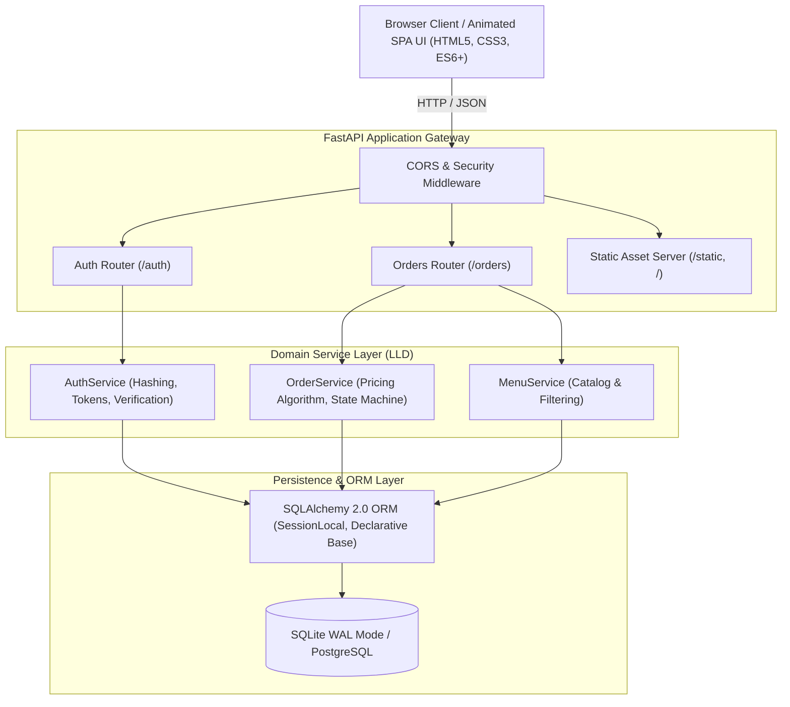

# 🍕 SliceCraft Artisanal Pizza Delivery & Kitchen Dispatch Platform

A production-grade, highly responsive, full-stack Pizza Delivery and Kitchen Dispatch platform built with **FastAPI**, **SQLAlchemy 2.0**, **Pydantic**, **JWT Authentication (RBAC)**, and an animated **Single Page Application (SPA)** frontend.


---

## 🌟 Key Highlights & Features

- 🍕 **Artisanal Menu Catalog**: Hand-stretched wood-fired pizza selections with dynamic category filtering (Classic, Meat Lovers, Vegetarian, Specialty), ingredient tags, and real-time search.
- 🛠️ **Custom Pizza Crafter ("The Artisan Oven")**: Interactive customizer modal for selecting dough fermentation style, crust type (Hand-Tossed, Thin, Cheese-Stuffed, Cauliflower Gluten-Free), size scaling (Small 10", Medium 12", Large 14", Extra-Large 16"), and gourmet toppings with live algorithmic pricing.
- 🛒 **Reactive Shopping Cart & Seamless Checkout**: Sliding cart drawer with dynamic delivery fee calculations (Free Delivery over \$25), tax computation, persistent browser storage, and instant order placement.
- 🛵 **Real-Time Live Order Tracker**: 4-stage visual progress stepper (`PENDING` ➔ `BAKING` ➔ `IN-TRANSIT` ➔ `DELIVERED`) with live status badges and customer order history.
- 👨‍🍳 **Kitchen Staff & Dispatch Center (Admin Portal)**:
  - Real-time business intelligence telemetry (Total Revenue, Total Orders, In Queue, In Transit, Delivered).
  - Dispatch board for transitioning order statuses or canceling/deleting orders.
  - Role-Based Access Control (RBAC) protecting staff endpoints.
- ⚡ **Interactive Demo Persona Switcher**: One-click authentication switcher for instant testing:
  - **Customer**: `johndoe` / `Password123!`
  - **Kitchen Staff / Admin**: `admin` / `Admin@123`
- 🎨 **Modern Design & Micro-Animations**:
  - Rotating 3D pizza stage with rising steam particles and wood-fired oven glow.
  - Glassmorphic UI with responsive mobile navigation and Web Audio API chime feedback.
- 🧪 **100% Passing Automated Test Suite**: Comprehensive unit tests covering authentication, order placement, pricing multipliers, and RBAC security.

---

## 🏛️ System Architecture: HLD & LLD

### High-Level Design (HLD)



### Low-Level Design (LLD)

```
Pizza Delivery/
├── app/
│   ├── core/
│   │   ├── config.py           # 12-factor application settings & Pydantic Config
│   │   ├── database.py         # SQLAlchemy engine, WAL pragma, session lifecycle
│   │   └── security.py         # PBKDF2:SHA256 password hashing & verification
│   ├── models/
│   │   ├── user.py             # User model with sanitized dictionary serializer
│   │   ├── order.py            # Order model with status/size normalization
│   │   └── menu.py             # PizzaMenu catalog model
│   ├── schemas/
│   │   ├── auth.py             # SignUpModel, LoginModel, TokenResponseModel
│   │   ├── order.py            # OrderModel, OrderStatusModel, OrderStatsResponse
│   │   └── menu.py             # PizzaMenuItemSchema
│   ├── services/
│   │   ├── auth_service.py     # Registration, login verification, profile logic
│   │   ├── order_service.py    # Pricing matrix, state machine, dispatch telemetry
│   │   └── menu_service.py     # Menu querying and category filtering
│   └── api/
│       ├── deps.py             # Security dependencies (get_current_user, get_current_staff)
│       └── v1/
│           ├── auth.py         # /auth endpoints
│           └── orders.py       # /orders endpoints
├── static/
│   ├── index.html              # Responsive Single Page Application
│   ├── css/
│   │   └── styles.css          # Glassmorphism, animations, responsive layout
│   └── js/
│       └── app.js              # State management, cart, live polling, audio feedback
├── tests/
│   └── test_api.py             # Automated unit and integration test suite
├── main.py                     # Entry point & static mounting
├── init_db.py                  # Idempotent database schema & seed script
├── test_api.py                 # Root test runner
├── decisions.md                # Technical Interview Q&A System Design Record
└── requirements.txt            # Application dependencies
```

---

## 📡 API Reference & Endpoints

| Method | Route | Description | Access Level |
| :--- | :--- | :--- | :--- |
| **GET** | `/` | Serves the interactive Single Page Application UI | Public |
| **GET** | `/health` | System health and service readiness probe | Public |
| **POST** | `/auth/signup` | Register a new customer or staff account | Public |
| **POST** | `/auth/login` | Authenticate user and receive JWT Access & Refresh tokens | Public |
| **GET** | `/auth/me` | Fetch authenticated user profile data | Authenticated |
| **PUT** | `/auth/me` | Update phone, default address, or email | Authenticated |
| **GET** | `/auth/refresh` | Refresh an expired access token | Authenticated (Refresh Token) |
| **GET** | `/orders/menu` | Retrieve handcrafted pizza catalog with category filtering | Public |
| **POST** | `/orders/order` | Place an artisanal pizza order | Authenticated |
| **GET** | `/orders/user/orders`| Retrieve order history for logged-in user | Authenticated |
| **GET** | `/orders/user/order/{id}`| Retrieve a specific order belonging to current user | Authenticated |
| **PUT** | `/orders/order/update/{id}`| Update delivery address, size, or notes while `PENDING` | Order Owner / Staff |
| **DELETE**| `/orders/order/delete/{id}`| Cancel a `PENDING` order | Order Owner / Staff |
| **GET** | `/orders/orders` | List all orders with real-time status and search filtering | **Staff Only** |
| **GET** | `/orders/stats` | Retrieve aggregated kitchen KPIs and financial revenue | **Staff Only** |
| **PUT** | `/orders/order/status/{id}`| Transition order status (`PENDING` ➔ `IN-TRANSIT` ➔ `DELIVERED`)| **Staff Only** |
| **GET** | `/docs` | Interactive Swagger UI API Documentation | Public |

---

## 🚀 Getting Started

### 1. Prerequisites
- Python 3.10+ (Recommended: Python 3.12)
- Virtual Environment tool (`venv`, `pipenv`, or `uv`)

### 2. Installation & Setup

```bash
# Clone the repository
git clone https://github.com/vaibhav2616/Pizza-Delivery-API.git
cd "Pizza Delivery"

# Activate your virtual environment
# Windows:
.\myenv\Scripts\activate
# Linux/macOS:
source myenv/bin/activate

# Install dependencies
pip install -r requirements.txt
```

### 3. Initialize & Seed Database
```bash
python init_db.py
```
*Creates database schema and seeds 8 gourmet pizzas, default staff (`admin` / `Admin@123`), customer (`johndoe` / `Password123!`), and sample demonstration orders.*

### 4. Launch the Server
```bash
uvicorn main:app --reload
```
Open your browser at:
- **Interactive Ordering Web App**: [http://127.0.0.1:8000/](http://127.0.0.1:8000/)
- **Interactive Swagger Documentation**: [http://127.0.0.1:8000/docs](http://127.0.0.1:8000/docs)

---

## 🧪 Running Automated Tests

Run the full automated test suite verifying 100% code correctness:

```bash
python -m unittest test_api.py -v
```

Output:
```
test_01_menu_retrieval ... ok
test_02_user_signup ... ok
test_03_duplicate_signup_rejection ... ok
test_04_login_success_and_failure ... ok
test_05_place_order_and_price_calculation ... ok
test_06_user_order_history ... ok
test_07_staff_order_management ... ok
test_08_rbac_security_enforcement ... ok
test_09_order_deletion_by_customer ... ok
test_10_invalid_status_rejection ... ok
test_11_order_modification_constraints ... ok
test_12_pricing_algorithm_multipliers ... ok
----------------------------------------------------------------------
Ran 12 tests in 0.55s

OK
```

---

## 📖 Architecture Decision Record (ADR)

For an in-depth interview-style technical breakdown detailing all architectural decisions, design patterns, framework trade-offs, and scaling strategies, see **[`decisions.md`](./decisions.md)**.
